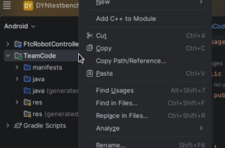
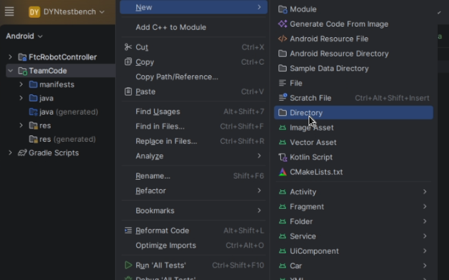
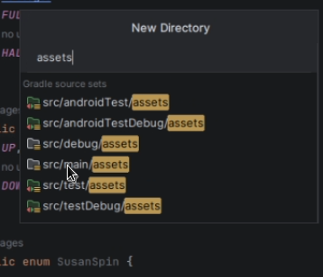
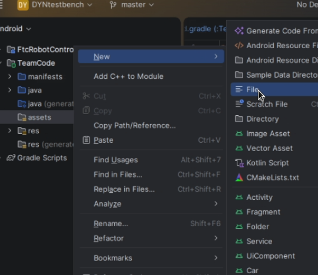
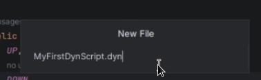

# Your First DYN script

Before you start writing DYN code, you have to choose where you will store the DYN scripts.
You have the option between using a USB drive, or androids built in `assets` folder.
<br/>Each method has its advantages and disadvantages.

### DYN Language Plugin

TODO

### Using a USB drive

A USB drive setup needs some special setup beforehand.
You'll want a blank USB with nothing important on it, because the control can only work with a strange set of drive formats.

The drive needs FAT32 formatting using a MBR/msdos [partition table](https://en.wikipedia.org/wiki/Disk_partitioning#Partition_table).
<br/>We suggest that teams use [gParted](https://gparted.org/) for this.

<small>If you want to use a different program, it needs to<br/>1) format to FAT32 &<br/>2) create MBR/msdos partition tables.</small>

<br/>***MAKE SURE THAT THE DRIVE YOU WANT TO FORMAT HAS NO IMPORTANT DATA ON IT AND THAT YOU FORMAT THE CORRECT DRIVE***

Once your drive is formatted properly, you'll be able to start writing DYN scripts to it.

### The assets folder

This method uses androids built-in asset folder.
<br/><small>AKA: the magic .apk data thingy.</small>

In your Android Studio project, right click on your `TeamCode` folder.



Click `New` then click `Directory`.



Type in `assets` and click on `src/main/assets`.



Now you'll have assets folder in you TeamCode folder.
<br/>Right click on it, click `New` then select `File`



Type in your scripts name, and make it a `.dyn`. I used `MyFirstDynScript.dyn` here.



### Script Loading Pros & Cons

| Method        | Pros                                                                           | Cons                                                                                                                                                                                        |
|---------------|--------------------------------------------------------------------------------|---------------------------------------------------------------------------------------------------------------------------------------------------------------------------------------------|
| USB loading   | <ul><li>Much faster script development and itteration pipeline.</li></ul>      | <ul><li>Needs a USB and formatting software.</li><li>USB can disconnect from extreme movements if not properly secured causing fallback to `assets` folder on <u>OpMode init</u>.</li></ul> |
| Assets folder | <ul><li>Allways there, never drops out like a spotty USB connection.</li></ul> | <ul><li>Very slow to update.</li></ul>                                                                                                                                                      |

### A Sample Script

In DYN, everything is required to be inside a "Path".
<br/><small>AKA: a function</small>

DYN scripts are held inside of simple text files with the suffix `.dyn`.

I will get into all the details of *what* all of this is, but you want to first state a main function.
<br/><small>DYN defaults to `Main` for its main function.</small>

```DYN
def_path Main start // Main is this functions name
end
```

Then you want to tell DYN what function to run.

```DYN
def_path Main start
end

auto_path Main // tells DYN what function to run
```

Let's add some telemetry and sleeping.

This will add `Hello...` to telemetry on the DS, adds `... From DYN!` to it after 5 seconds, then waits another 5 seconds and stops the OpMode.

```DYN
def_path Main start
    // Adds this string to the telemetry buffer and sends it to the DS
    AddData "Hello..."
    Update

    // Sleep for 5 seconds, DYN's sleep works in ms
    Sleep 5000

    // Because the Update command doesnt clear the buffer, we can just add onto it.
    AddData "From DYN!"
    Update

    // Sleep another 5 seconds
    Sleep 5000

    // This stops the DYN script AND the OpMode
    HardQuit
end

auto_path Main
```

Put that into a DYN file into your `assets` folder or onto your sacrificial USB,
and your good to go to the next section.

TODO: get Docusaurus to do DYN syntax highlighting.